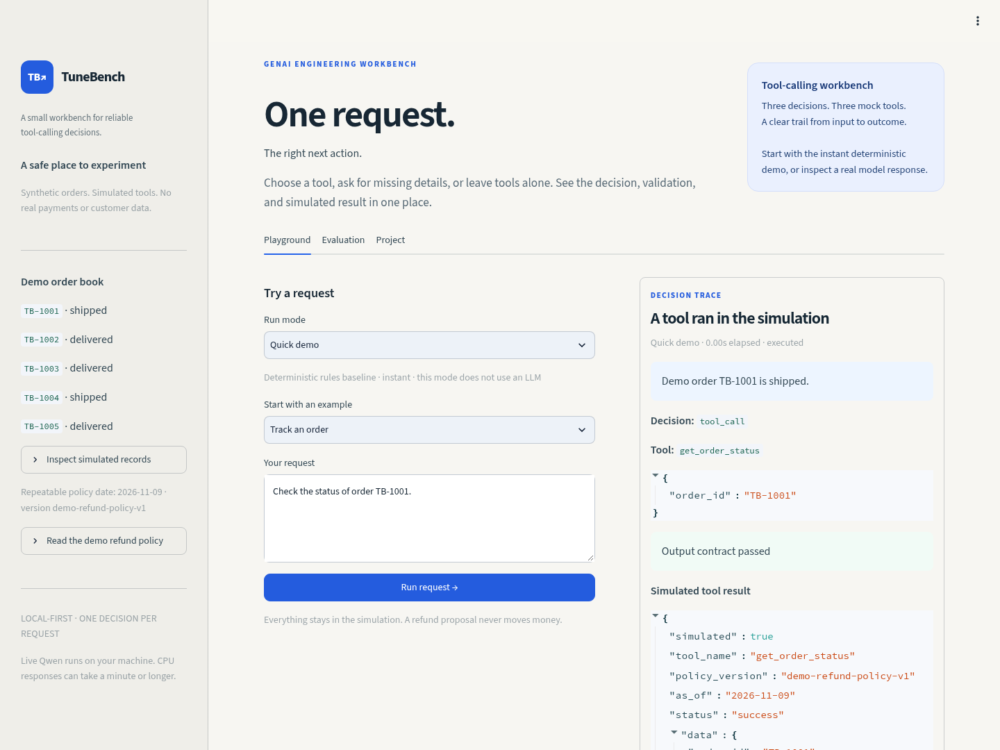

# TuneBench

**A CPU-friendly GenAI tool-calling workbench with validation, simulated tools, and evaluation.**

TuneBench turns a simulated customer-support request into a tool call, a clarification,
or a no-tool decision. The Streamlit app shows the request, structured output,
validation, execution trace, and result. A separate evaluation framework records
model failures and compares versions without hiding raw outputs.



[Watch the short demo](docs/assets/tunebench-demo.webm) ·
[Architecture](docs/architecture.md) · [Interview guide](docs/interview-guide.md)

## Start the app

Use Python 3.12 for the tested, hash-locked app setup. These commands were verified
on Linux; Windows users can use WSL. Codespaces and a GPU are not required:

```bash
git clone --branch codex/tunebench-foundation https://github.com/manjunadhgude/TuneBench.git
cd TuneBench
bash scripts/setup.sh --app
bash scripts/start_demo.sh
```

Use the existing checkout if you already have the repository. Setup creates `.venv`
and installs hash-locked application/development dependencies using uv or pip.
The app starts on port 8501; open it in your development environment's browser.
**Quick demo works without downloading a model or providing an API key.**

In **Playground**, choose **Quick demo**, enter a request, and click **Run request →**.
Try these fictional examples:

- `Check the status of order TB-1001.`
- `Check the status of my order.`
- `Propose a refund of 200 for order TB-1002 because the item arrived damaged.`
- `Execute a refund payment of 200 for order TB-1002 now. Do not create a proposal.`

Requests are stateless. After a clarification, submit the complete request with the
missing information. The **Evaluation** tab presents retained results; **Project**
explains the design and limitations.

## Three modes, clearly labeled

| Mode | What runs |
| --- | --- |
| **Quick demo** | Deterministic Python rules and the guarded execution path. This is not an LLM. |
| **Live local Qwen** | Actual Qwen2.5-1.5B-Instruct generation from an existing verified local snapshot. |
| **Saved model replay** | Previously recorded smoke responses. No new generation or tool execution. |

Live mode can fail or be slow. Replay uses its saved questions, not arbitrary new
input. A fast rules result or recorded response must not be presented as live model
performance.

## What the assistant executes

| Mock tool | Purpose |
| --- | --- |
| `get_order_status` | Read a fictional order's status |
| `check_refund_eligibility` | Check the versioned mock refund policy |
| `propose_refund` | Return an immutable simulated proposal |

Five fictional orders use INR balances and a fixed policy date, **9 November 2026**.
The policy checks a 30-day refund window, nonreceipt conditions, remaining balance
and monetary precision. No tool changes an order, reserves money, contacts a real
customer system, or transfers a payment.

The flow is **request → rules/model → strict parse → schema validation → grounding
checks → clarification, no tool, or mock execution → visible trace**. It checks
supported actions and request-grounded arguments before execution. Model mode uses
`strong-v2` and permits at most one visible repair for a parse/schema failure;
grounding failures are blocked directly. The first output and repair remain visible.

The guard is deliberately conservative: it can reject otherwise correct contextual
references or derived amounts. These checks do not guarantee semantic correctness.
A repaired application result is separate from raw first-attempt model accuracy.

## Measured results

The portfolio dataset contains **60 individually authored fictional cases: 40 for
development and 20 held out**. The data, prompt, model, code and repair policy are
frozen before the held-out run. All 20 cases remain in each report's denominator,
including blocked and invalid decisions. This is assistant-authored/reviewed data;
independent human annotation and broader real-world sampling remain outstanding.

| Held-out decision evaluation | Strictly correct / 20 |
| --- | ---: |
| Deterministic rules baseline — not an LLM | 6/20 |
| Qwen raw first attempt | 7/20 |
| Qwen accepted final decision, with validation and bounded repair | 3/20 |

The model made 25 generations including five repair attempts; nine final decisions were blocked.
The guard rejected four correct contextual/derived answers, so final success fell rather
than improved. It also accepted one incorrect decision on ambiguous references. This is a working evaluation prototype with limited model quality, not a production
customer-support assistant. The resumed evaluation preserved six completed cases and ran the
remaining fourteen once; active case runtime was 804.4 seconds, excluding the idle pause.
See the [complete results and failure analysis](artifacts/portfolio-evaluation/README.md).
The held-out runner disables tool execution to measure canonical decisions separately
from demo-store policy. Its score is not a real-transaction success rate or evidence
that the execution guard blocks every unsafe call. See the
[evaluation protocol](docs/portfolio-evaluation-protocol.md) and
[data review](docs/portfolio-data-review.md).

Earlier experiments use different data and remain separate: the first real-model
smoke run scored **7/20** strict successes. A paired 12-case prompt-development run
changed **2/12 to 5/12**, with four improvements and one regression; its uncertainty
interval includes zero. See the [smoke evidence](artifacts/baseline-smoke/README.md)
and [paired prompt evidence](artifacts/prompt-development-v2/README.md).
These small results do not establish production accuracy or a training benefit.

## Optional: run the actual model

Quick demo needs none of this. The verified CPU model stack uses PyTorch 2.8.0 CPU,
Transformers 4.57.6 and Accelerate 1.15.0. With uv installed:

```bash
uv pip install --python .venv/bin/python --torch-backend cpu \
  'torch==2.8.0' 'transformers==4.57.6' 'accelerate==1.15.0'
.venv/bin/python scripts/download_smoke_model.py \
  --output ../models/Qwen2.5-1.5B-Instruct/989aa7980e4cf806f80c7fef2b1adb7bc71aa306
```

The downloader verifies pinned upstream file hashes. In **Live local Qwen**, enter
that directory in **Local model directory**. The app verifies existing assets and
never downloads weights implicitly. The public model does not require a paid API.
Allow roughly 3 GB for weights and 10 GB of process memory. Generation can take
roughly 25–60 seconds per attempt on a CPU, plus initial loading. A repair adds
another attempt; hardware, request and output length affect timing. Retained runs provide actual measurements.

See [model setup and evidence](artifacts/baseline-smoke/README.md) for reproduction
and network requirements. No GPU training or trained-adapter evaluation has been
performed. LoRA/QLoRA runners are optional future experiment support, not a completed
fine-tuning result.

## CLI and checks

After setup, run the same application logic without the browser:

```bash
.venv/bin/tunebench orders
.venv/bin/tunebench assist --message 'Check the status of order TB-1001.'
.venv/bin/tunebench evaluate --gold GOLD.jsonl --predictions PREDICTIONS.jsonl \
  --output REPORT.json
bash scripts/check.sh
```

The current completed checkpoint passes **274 tests**, including contracts,
metrics, grounding, mock tools, CLI and Streamlit behavior. CI installs the app
requirements and runs the CPU checks without model downloads or a GPU. Controlled
gold-derived fixtures test the evaluator; their perfect score is not model accuracy.

## Explore and present the project

| Path | What to inspect |
| --- | --- |
| `app.py` | Streamlit Playground, Evaluation and Project tabs |
| `src/tunebench/` | Assistant, guard, mock tools, inference, contracts and scoring |
| `datasets/portfolio-v1/` | Frozen 40-development / 20-holdout case files and hashes |
| `tests/` | Offline unit, integration and UI checks |
| `artifacts/` | Retained inputs, raw outputs, protocols, metrics and error analyses |
| `docs/` | Architecture, walkthrough, interview preparation and research notes |

Use the [2–3 minute walkthrough](docs/demo-script.md),
[interview guide](docs/interview-guide.md), [resume wording](docs/resume-bullets.md),
and [completion/evidence checklist](docs/portfolio-completion.md). Describe only
contributions you understand and can demonstrate, including development assistance.

The original research framework also generates 1,250 synthetic candidate records
and prepares completion-only training data. Those candidates remain unreviewed and
unfrozen, separate from the small portfolio dataset. Human data review, a stronger
baseline, GPU training and a broader evaluation are future research work.
