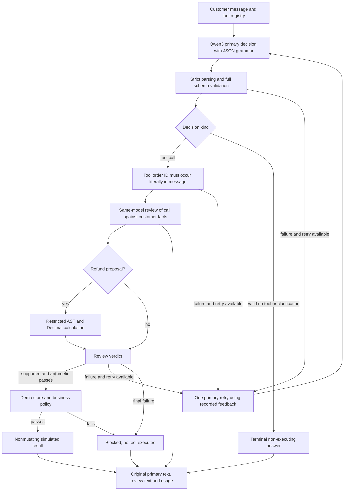

# TuneBench architecture

The CLI and Streamlit app use the same Python package. They preserve the model's
original answer separately from review, retry, acceptance, and mock execution.

## Qwen3 live pipeline in v0.7.1

This diagram describes the preferred GGUF profile. Quick demo uses deterministic
rules with regex evidence checks. Historical replay performs no generation or
execution. Legacy Qwen2.5/PyTorch retains the older guard. Requests are stateless;
a follow-up must contain the complete message and missing details.

## Model and budgets

The primary is Unsloth's Apache-2.0 Q4_K_M conversion of the official
Qwen3-4B-Instruct-2507. Exact size and SHA-256 are verified before loading.
This is neither an official Qwen GGUF release nor our trained model.
`llama-cpp-python==0.3.36` uses zero GPU layers, four CPU threads, ChatML,
greedy decoding, seed 42, and at most 256 new tokens per primary generation.
The primary context is 8192 tokens. The separate cached review session uses a
4096-token context and up to 256 new tokens. Each session has its own lock.
There are at most two primary generations and two reviews per request. An
unavailable reviewer fails closed. No implicit model downloads or rules fallback.

## What validation proves

Full schema validation checks one of three decision contracts and the required
arguments for exactly three mock tools. JSON grammar guides syntax; neither it
nor schema validation proves semantic correctness.

The reviewer produces reasoning first, then a calculation and a verdict. It
reviews tool calls only. Valid clarification and no-tool decisions are terminal;
review feedback cannot reopen them or induce tool execution. Their schema and
required fields are still validated. Schema-invalid output remains repairable.
It is the same model as the proposer, so correlated mistakes remain possible.
A rejected review can trigger one primary retry; it never rewrites an accepted
answer. Feedback includes model judgement and arithmetic errors, not test gold.

For a proposed refund, the reviewer must provide an expression using source
numbers. A restricted Python AST interpreter supports +, -, *, /, min, max,
parentheses, and unary signs. Decimal precision is 40. Expression length, AST
size, operand values, and results are bounded. No eval, arbitrary calls,
attributes, powers, or imports are allowed. Numeric operands must occur in the
customer's text, including common number words and a few structural constants.
This is arithmetic validation, not a formal proof of grounding: a model can pick
the wrong source number or expression. A stated price alone does not authorize
a refund amount. No rounding or currency conversion is silently inferred.

Regex diagnostics remain in the trace as advisory information. For the GGUF
profile, they no longer decide whether a semantically reviewed call is accepted.
Literal order-ID presence and complete schema checks remain deterministic gates.

## Mock execution

| Tool | Required arguments |
| --- | --- |
| get_order_status | order_id |
| check_refund_eligibility | order_id, reason |
| propose_refund | order_id, reason, refund_amount |

Only five fictional INR orders exist. The versioned mock policy uses a fixed
9 November 2026 date, a 30-day window, nonreceipt conditions, remaining balance,
and two-decimal monetary precision. Policy failures block execution without
another generation. Nothing mutates an order or transfers money.

## Evaluation

Only customer text and tool definitions reach the primary model. Only customer
text and the primary decision reach the reviewer. Gold, case identifiers,
splits, difficulty labels, and annotation rationales are used only for scoring.

The historical v0.7 paired comparison uses archived v0.6 source `5559e30` and v0.7 source
frozen at `eb4e227`, with identical primary weights, prompt, and decoding.
Forty new author-reviewed cases were frozen before either generation. Source,
model, dataset, prompt, selected library, and runner hashes are checked; sequential
isolated workers preserve durable journals and reject ambiguous crash resumes.
Review calls are counted in total generation cost. This is a pipeline comparison,
not matched total compute or a pure prompt experiment. Execution is disabled.

The evaluator keeps every failed/blocked case in the denominator, separates
first-answer accuracy from accepted-final accuracy, and reports each outcome
kind. A separate computational audit reparses original model text and recomputes
scores; it is not independent human annotation or an external research audit.

The v0.7.1 fix was frozen at `09dd1bc` before 12 new targeted cases were authored.
It preserves the old benchmark and separately checks the no-escalation invariant,
new CPU requests, and legitimate tool calls. See [focused reliability evidence](../artifacts/terminal-reliability-v071/README.md).

See [historical evidence](../artifacts/semantic-comparison-v7/README.md) and
[status](status.md). The earlier 7/20 and unsuccessful guard experiment remain
visible. No model fine-tuning, production reliability claim, or real payment
integration follows from these small synthetic tests.
