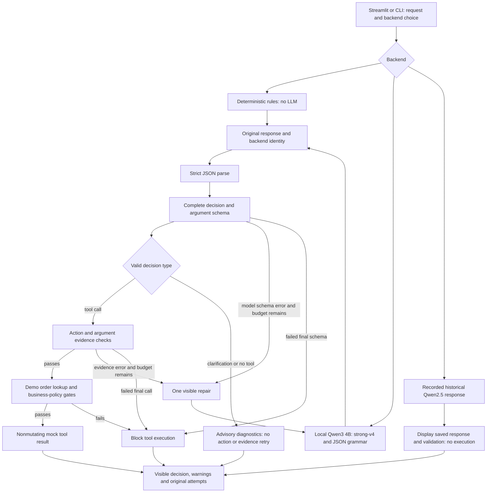
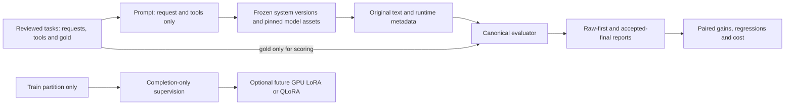

# TuneBench architecture

TuneBench demonstrates a tool-calling assistant and measures the quality of its
decisions. The Streamlit app and CLI share the same Python package. Original
model answers remain separate from validation, repair and mock execution.

## One request through v0.5

The preferred live backend is Qwen3-4B-Instruct-2507 through `llama-cpp-python`
0.3.36 on CPU. Its pinned Q4_K_M GGUF is Unsloth's Apache-2.0 conversion of the
official Qwen model, not an official Qwen GGUF release. The loader checks exact
file size and SHA-256 before loading. It uses zero GPU layers, four generation
threads, ChatML, an 8192-token context, greedy decoding and at most 256 new tokens.
A lock protects one cached model session. Each request gets a fresh JSON grammar.

The verified Qwen2.5-1.5B snapshot remains available as a legacy profile, using
PyTorch float32, `strong-v3` and lm-format-enforcer. The selected model/runtime is
recorded in the result metadata. Neither backend silently downloads weights or
falls back to rules. The rules and replay modes are explicitly labeled; replay
uses saved questions and performs no new inference or execution.

## Contracts and execution

“Tool calling” means choosing a named function with typed arguments, then letting
application code validate and dispatch it. Only three mock operations exist:

| Tool | Required arguments | Behavior |
| --- | --- | --- |
| `get_order_status` | `order_id` | Read a fictional order's status |
| `check_refund_eligibility` | `order_id`, `reason` | Apply the mock eligibility policy |
| `propose_refund` | `order_id`, `refund_amount`, `reason` | Return a simulated proposal without changing balances or transferring money |

A JSON grammar guides structure; complete schema validation still checks the
result. Neither grammar nor schema establishes that an action, reference, reason
or amount is correct. Tool calls pass through evidence checks against the request.
The extractor handles literal references, explicit corrections, reason facts and
exact `Decimal` calculations from supplied quantities/prices or percentages/bases.
Missing factors are not invented. The language rules remain bounded and can make
mistakes.

The v0.5 policy treats **schema-valid no-tool and clarification decisions**
differently. Heuristic grounding disagreements are advisory: they do not block
those non-executing decisions or trigger a retry that turns them into actions.
They can still be wrong decisions, and the evaluator counts them as quality
errors. Schema-invalid output can use the bounded schema repair. An actual tool
call still needs supported action and argument evidence before execution.

Model mode permits at most one repair for a schema failure or tool-call evidence
failure. Feedback contains errors and facts extracted from the request, never a
benchmark answer key. The model generates the next answer itself. Application
code never replaces its output with the deterministic rules decision. Both raw
attempts and advisory/validation diagnostics remain visible. Mock order-book and
business-policy failures are separate execution gates and do not trigger retries.

The bundled store has five fictional orders, INR values and a fixed policy date
of **9 November 2026**. Delivered damaged/wrong-item/changed-mind requests use an
inclusive 30-day window; nonreceipt requires a shipped order past its expected
date. A proposal cannot exceed the remaining refundable balance. These policy
checks run only for simulated execution, not when scoring canonical benchmark
decisions. No operation contacts a customer system or executes a real payment.

The assistant API is `respond(message, backend="rules", ...)`. It returns backend
identity, original attempts, accepted outcome, errors/advisories, elapsed time and
an optional mock-tool result. Status is `executed`, `clarification`, `no_tool`,
`blocked` or `error`; decision-only evaluation can return `validated`. Requests
are stateless across submissions, so a follow-up must include the complete facts.

## Measurement stays separate

Gold labels, case IDs, split names and difficulty labels never enter model prompts.
The evaluator distinguishes parseable JSON, schema validity, outcome choice, tool
selection, arguments, clarification fields, no-tool reason and strict success.
Missing, invalid and blocked decisions remain in the denominator. Clarification
question wording is checked for contract validity rather than human-graded
helpfulness. Per-outcome raw/final results are required: a high aggregate score
can mask false blocking of valid tool calls. Incorrect accepted calls are also
reported rather than treating every accepted decision as correct.

The v0.5 quality experiment freezes both sources, the 40-case data, model assets,
selected libraries and budgets before generation. Isolated sequential workers
import v0.4 from `7498d78` and v0.5 from `5d52dc8`. Journals retain every original
answer and repair, with durable case checkpoints and strict resume checks. All 40
cases are scored for both versions, including backend errors. Execution is disabled
so order-store policy does not distort canonical decision accuracy.

The baseline is Qwen2.5-1.5B float32; the candidate is Qwen3-4B Q4_K_M. Prompt,
quantization, runtime, JSON constraints, guard and repair behavior change together.
This measures complete systems under shared CPU/token/repair limits, not a model
or prompt ablation. No model training has been performed. See the
[quality comparison protocol](quality-comparison-protocol.md).

## Evidence and limits

Development selection changed 37/40 to 40/40 strict successes on the same practice
cases. That is tuned development coverage, not unseen quality. The separate
40-case comparison and computational score audit are running at this checkpoint;
new held-out scores will be reported only after both complete.

The earlier matched 20-case comparison measured raw success 8/20 → 9/20 and
accepted final success 2/20 → **7/20** for v0.3/v0.4, with unchanged Qwen2.5 weights.
The guard/repair path lost five correct first answers and repaired three errors.
That evidence motivated the stronger model and revised policy; it remains in the
[historical report and audit](../artifacts/portfolio-version-comparison/README.md).
It cannot be directly compared with a score from the new 40 questions.

The initial smoke scored 7/20; the separate 12-case prompt-development experiment
changed 2/12 to 5/12. The original v0.3 portfolio holdout scored 7/20 raw and 3/20
final. Those datasets and outputs remain separate historical measurements.

Portfolio cases are fictional, stratified and authored/reviewed by assistants;
separate blinded assistant review is not independent human annotation. Structural
non-overlap checks do not prove semantic novelty or representative traffic. Small
results do not establish production reliability or real execution safety. The
1,250-record research benchmark remains candidate/unreviewed, and optional
training support is not evidence of a trained adapter.

## Component choices

| Choice | Purpose and trade-off |
| --- | --- |
| Python package shared by CLI and Streamlit | Keep behavior testable outside a web session |
| Quantized local CPU model | Run actual inference without a GPU or paid API; quantization/runtime affect quality and cost |
| JSON grammar plus complete validation | Guide structure and check the full contract; still requires semantic evidence checks |
| Nonmutating mock tools | Make policy handling reproducible without real transactions |
| Original output and run metadata | Make failures, repairs and comparisons inspectable |
| Completion-only training export | Prepare future supervision while excluding prompt tokens from loss |

The task selects actions against a small registry, so it does not require a vector
database or RAG pipeline. Authentication, customer integrations, broad adversarial
evaluation, monitoring and a production deployment remain outside this simulation.
