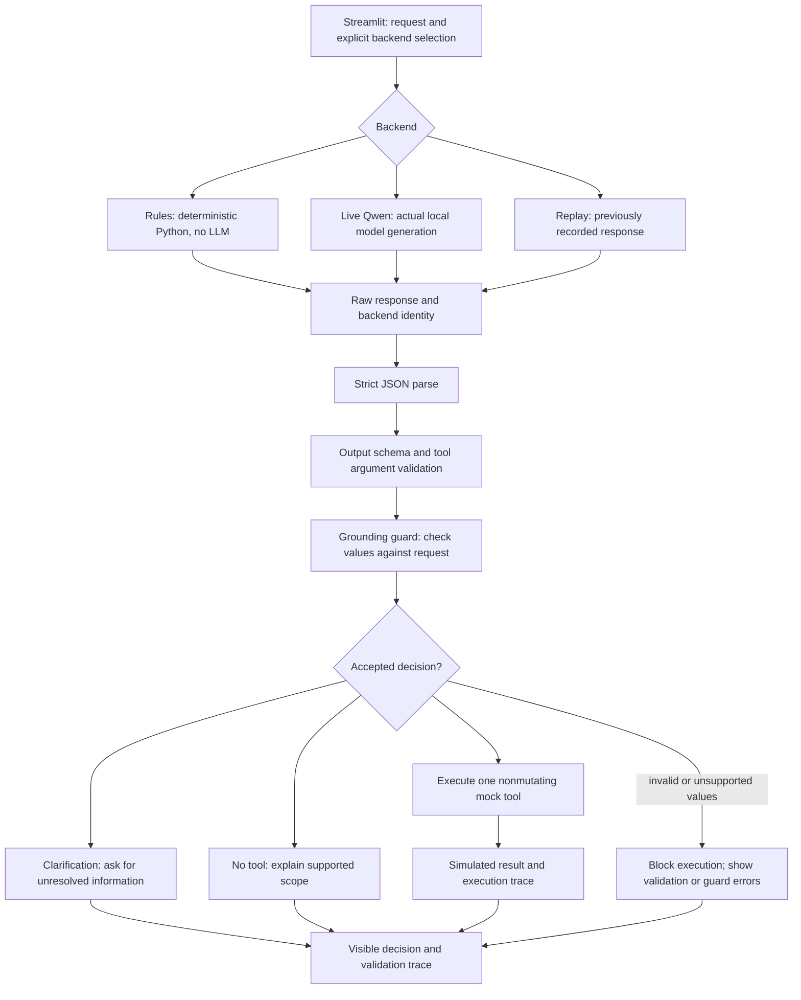
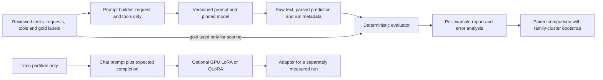

# TuneBench architecture

TuneBench has two connected uses: demonstrate how a tool-calling assistant handles
one request, and measure how reliably a model makes that decision. The assistant
is a small customer-support simulation. The experiment framework preserves raw
model mistakes so that an attractive demo cannot silently inflate research scores.

## A request through the assistant

“Tool calling” means selecting a named function and structured arguments, then
letting application code validate and dispatch the call. The model itself cannot
access orders or execute payments. Only the three registered mock operations are
available:

| Tool | Required arguments | Demonstrated behavior |
| --- | --- | --- |
| `get_order_status` | `order_id` | Read a simulated order's status |
| `check_refund_eligibility` | `order_id`, `reason` | Apply the mock eligibility policy |
| `propose_refund` | `order_id`, `refund_amount`, `reason` | Return a simulated proposal without transferring money |

Schema validation checks shape, known fields, argument types and allowed values.
The grounding guard adds checks that a schema cannot express, such as whether a
proposed order reference or amount is supported by the request. These checks are
bounded engineering rules. They do not establish that every possible natural-language
request is understood correctly. Unknown orders and unsupported actions must be
visible outcomes, rather than successful-looking fabricated results.

The rules backend makes the UI quick to demonstrate on a CPU without downloading a
model. It is not an LLM baseline. Live Qwen uses actual model generation and can be
slow or wrong. Replay presents retained output without generating it again; it is
recorded evidence, not a new inference request. The backend identity belongs beside
the result, not only in developer logs. The UI names these modes **Quick demo**,
**Live local Qwen**, and **Saved model replay**. Replay exposes only its saved
questions and responses and does not execute a tool. The interactive assistant is
stateless: a clarified follow-up must include the complete request.

## A separate measurement path

Gold labels, family IDs, split names and difficulty labels are excluded from model
prompts. Dataset generation and scoring are independent of model inference. This
lets tests inject known predictions without downloading weights, while actual
model runs retain their own evidence.

The evaluator reports several dimensions because they answer different questions:
JSON parsing, schema validity, outcome choice, tool selection, argument correctness,
clarification fields, no-tool decisions, and strict end-to-end task success. Correct
tool selection can receive independent credit even when the arguments are wrong.
Strict task success still fails that example. Missing or invalid predictions remain
in the denominator and diagnostics.

## Raw model output versus the assistant's final response

Keep these three objects distinct:

1. **Raw output:** the exact text returned by a model or recorded backend.
2. **Parsed decision:** the structured object obtained by strict parsing and validation.
3. **Application result:** the clarification, blocked request, or mock-tool result shown
   after application checks.

If an assistant flow offers a repair or fallback, retain the first response and label
that intervention. A repaired final answer does not retroactively make the original
model prediction correct. The retained baseline and paired prompt experiments use
one attempt per question, with no repair or retry. Their original reports must not
be replaced by assistant-demo outcomes.

## Why these components

| Choice | Reason and trade-off |
| --- | --- |
| Python package with CLI | Run data, scoring and tests without depending on a web session |
| JSON Schema plus semantic checks | Give outputs an explicit contract; separately check request meaning |
| Streamlit | Provide a small inspectable portfolio interface without a separate frontend build |
| Mock tools | Demonstrate execution and policy handling with reproducible local data |
| Optional model dependencies | Keep the core install light; make real inference an explicit operation |
| Versioned prompts and run metadata | Make changes and comparisons reviewable |
| Completion-only training preparation | Teach expected assistant output while masking prompt tokens |

There is no vector database or RAG pipeline because this task is action selection
against a small tool registry. There is no production deployment claim: authentication,
real customer systems, financial transactions, broad adversarial evaluation and
operational monitoring are outside this portfolio scope.

## Evidence and limitations

The first real Qwen CPU smoke run scored **7/20** strict successes. On a separate
12-case paired development set, legacy `strong` scored **2/12** and `strong-v2`
scored **5/12**, including four improvements and one regression. Those are small,
constructed sets; they do not establish general accuracy or a training benefit.
No LoRA/QLoRA training or trained-adapter evaluation has been performed.

See the [initial experiment](../artifacts/baseline-smoke/README.md),
[paired prompt experiment](../artifacts/prompt-development-v2/README.md),
[dataset notes](dataset.md), and [implementation status](status.md).

## Interactive policy boundaries

The bundled mock store contains five fictional orders (`TB-1001`–`TB-1005`) and
uses a fixed policy date, **9 November 2026**, so results are reproducible. Amounts
are INR, represented with decimal handling in the tool layer. Delivered damaged,
wrong-item or changed-mind requests are evaluated against an inclusive 30-day
window; a not-received request requires a shipped order past its expected date.
A delivered-order dispute is not treated as proof of nonreceipt. A proposal cannot
exceed the remaining refundable amount and does not mutate that amount.

The interactive execution guard requires an explicit supported action, a known
order reference present in the request, a grounded reason and an explicit positive
amount where needed. It conservatively blocks unsupported substitutions and guessed
arguments. This is a narrower acceptance policy than all possible research examples:
a model may be asked to derive an amount in evaluation, while the interactive guard
can require the amount to be explicitly stated before execution.

The assistant API is `respond(message, backend="rules", ...)`. It returns a status
(`executed`, `clarification`, `no_tool`, `blocked` or `error`), backend identity,
raw attempts, accepted outcome, validation errors, optional tool result, user-facing
message and elapsed time. The model backend loads a local snapshot lazily; it does
not silently download weights or fall back to rules. It allows at most one visible
repair attempt for a parse/schema failure. Grounding or action-policy failure blocks
execution directly. These interactive interventions do not change the original
one-attempt research protocol.
